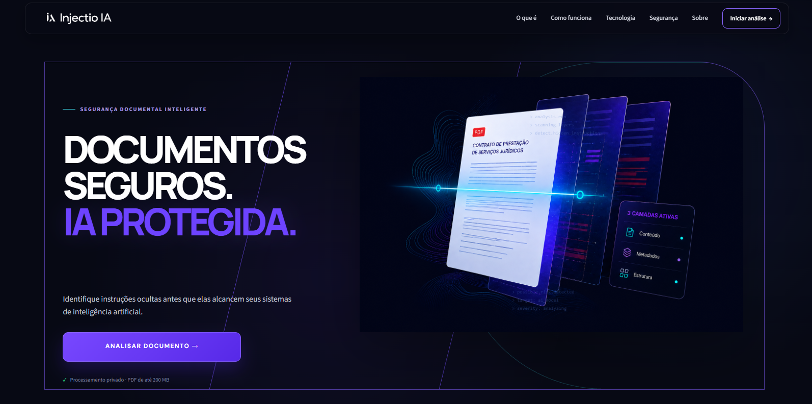
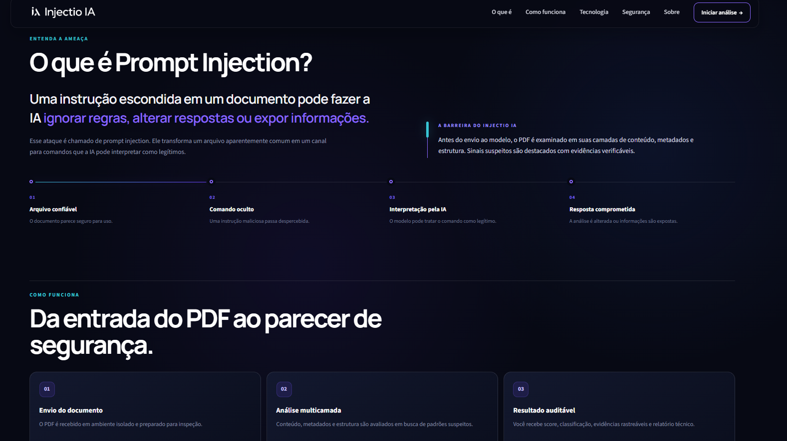

<div align="center">
  

  <h3>Segurança documental antes que o conteúdo alcance a IA.</h3>


  <p>
    
    
    
    
  </p>

  <p>
  <a href="https://injectio-ia.streamlit.app">
    
  </a>
</p>

</div>


O **Injectio IA 2.0** é uma aplicação de segurança documental desenvolvida em Python para identificar possíveis ataques de **Prompt Injection** em arquivos PDF antes que seu conteúdo seja processado por sistemas de Inteligência Artificial.

A solução utiliza uma **arquitetura híbrida**, combinando detecção heurística com **Inteligência Artificial Generativa (Google Gemini)** para analisar conteúdos suspeitos, identificar tentativas de manipulação e produzir resultados explicáveis.


O projeto aplica conceitos de **Engenharia de Software, Segurança em Inteligência Artificial e Large Language Models (LLMs)** em uma solução funcional, com interface web, API REST, testes automatizados e integração com modelos de IA Generativa.


🔗 **[Experimentar o Injectio IA 2.0](https://injectio-ia.streamlit.app/)**

<p align="center">
  
</p>


## 🔍 O que o projeto faz

- Analisa texto visível, conteúdo oculto e metadados de documentos PDF.
- Identifica padrões associados a tentativas de Prompt Injection.
- Calcula um **score de risco de 0 a 100**.
- Classifica documentos conforme o nível de risco.
- Localiza evidências por página, categoria e severidade.
- Utiliza o **Google Gemini** para realizar uma análise contextual complementar.
- Apresenta a justificativa e o trecho suspeito identificado pelo LLM.
- Gera relatórios técnicos em formato JSON.
- Disponibiliza interface interativa com Streamlit e API REST com FastAPI.
- Mantém a análise heurística disponível mesmo quando a API do Gemini está indisponível.


## 🤖 Arquitetura híbrida — Heurísticas + Gemini

O Injectio IA 2.0 combina duas abordagens complementares para identificar possíveis tentativas de Prompt Injection em documentos PDF.

### Camada 1 — Detecção heurística

Realiza uma inspeção técnica do documento utilizando padrões e regras de segurança.

- Examina texto visível, conteúdo oculto e metadados.
- Identifica instruções suspeitas e tentativas de manipulação.
- Classifica evidências por categoria e severidade.
- Calcula um score de risco de 0 a 100.

### Camada 2 — Análise contextual com Gemini

Utiliza o **Google Gemini** para interpretar contextualmente o texto extraído do PDF.

O modelo retorna uma resposta estruturada contendo:

- **Classificação:** presença ou ausência de indícios de Prompt Injection.
- **Categoria:** tipo de manipulação identificada.
- **Justificativa:** explicação do comportamento suspeito.
- **Trecho suspeito:** conteúdo que motivou a classificação.
- **Confiança estimada:** valor informado pelo modelo.

A integração utiliza **Google GenAI SDK** e **Pydantic** para validar as respostas.

### Tratamento de falhas

As duas análises funcionam de maneira independente.

Se a API do Gemini estiver indisponível, o diagnóstico heurístico continua acessível ao usuário.

A confiança estimada pelo LLM não representa uma precisão estatística comprovada.


## ⚙️ Como funciona

O Injectio IA realiza a inspeção documental em quatro etapas:

### 1. Envio do documento
O usuário seleciona um arquivo PDF pela interface Streamlit.

### 2. Inspeção heurística
O sistema extrai e examina textos, metadados e conteúdos potencialmente ocultos, identificando padrões associados a ataques de Prompt Injection.

### 3. Análise contextual com Gemini
Opcionalmente, o usuário pode solicitar uma segunda análise utilizando Inteligência Artificial Generativa. O Gemini avalia o conteúdo extraído e retorna uma classificação contextual acompanhada de justificativa e trecho suspeito.

### 4. Apresentação dos resultados
A aplicação disponibiliza o score de risco, as evidências identificadas, a classificação do Gemini e um relatório técnico em JSON.

A análise heurística permanece disponível mesmo quando a API do Gemini está indisponível.

## 🖥️ Interface

<table>
  <tr>
    <td width="50%" align="center">
      <br>
      <sub><b>Resultado da inspeção</b></sub>
    </td>
    <td width="50%" align="center">
      <br>
      <sub><b>Funcionamento e fluxo de análise</b></sub>
    </td>
  </tr>
  <tr>
    <td colspan="2" align="center">
      <br>
      <sub><b>Tecnologia e medidas de segurança</b></sub>
    </td>
  </tr>
</table>


## 🛠️ Tecnologias

**Linguagem:** Python 3.12

**Interface:** Streamlit

**API REST:** FastAPI e Uvicorn

**Inteligência Artificial Generativa:** Google Gemini e Google GenAI SDK

**Validação de dados:** Pydantic

**Processamento de PDFs:** PyMuPDF e pypdf

**Testes automatizados:** Pytest

**Controle de versão:** Git e GitHub


## 💻 Executar localmente

### 1. Clonar o repositório

```bash
git clone https://github.com/anaflaviabitu/injectio-ia.git
cd injectio-ia
```

### 2. Criar o ambiente virtual

```bash
python -m venv .venv
```

**No Windows (PowerShell):**

```powershell
.\.venv\Scripts\Activate.ps1
```

**No Linux ou macOS:**

```bash
source .venv/bin/activate
```

### 3. Instalar as dependências

```bash
pip install -r requirements.txt
```

### 4. Configurar o Gemini

Para utilizar a análise com IA Generativa, configure a variável de ambiente `GEMINI_API_KEY`.

**No Windows (PowerShell):**

```powershell
$env:GEMINI_API_KEY = Read-Host "Informe sua chave do Gemini"
```

**No Linux ou macOS:**

```bash
read -rs GEMINI_API_KEY
export GEMINI_API_KEY
```

A chave pode ser obtida no [Google AI Studio](https://aistudio.google.com/api-keys).

> **Segurança:** nunca publique sua chave de API no GitHub. A detecção heurística funciona mesmo quando o Gemini não está configurado.

### 5. Executar a interface

```bash
python -m streamlit run app.py
```

Acesse o endereço informado no terminal, normalmente `http://localhost:8501`.


**🚀 [Acessar demonstração online do Injectio IA 2.0](https://injectio-ia.streamlit.app/)**

A aplicação está publicada no Streamlit Community Cloud e permite realizar análises heurísticas e solicitar avaliações complementares com Google Gemini.

**Nota:** a disponibilidade da análise com Gemini depende da API externa e dos limites de utilização do serviço.

---

## 🧪 API e testes

### Executar a API REST

```bash
uvicorn main:app --reload
```

A documentação interativa da API estará disponível em `http://localhost:8000/docs`.

### Endpoints

| Método | Endpoint | Finalidade |
|--------|----------|------------|
| GET | `/health` | Verifica a disponibilidade da API |
| POST | `/analisar-seguranca` | Analisa um documento PDF |

### Executar os testes automatizados

```bash
pip install -r requirements-dev.txt
python -m pytest tests/ -q
```

**Última validação local:** 11 testes automatizados aprovados.

O detector heurístico também foi avaliado em um conjunto interno de 26 PDFs sintéticos, obtendo 100% de acurácia, precisão, recall e F1-score nesse conjunto específico.

Esses resultados não representam desempenho garantido em documentos reais. A camada Gemini ainda não possui avaliação estatística independente.

---

## 📁 Estrutura do projeto

<details>
<summary>Ver arquivos do projeto</summary>

```text
injectio-ia/
├── app.py
├── main.py
├── detector.py
├── llm_detector.py
├── extractor.py
├── patterns.py
├── avaliar_dataset.py
├── dataset/
├── tests/
├── docs/
├── injectio-logo.png
├── injectio-hero.png
├── requirements.txt
└── requirements-dev.txt
```

</details>

---

## ⚠️ Observações e limitações

O Injectio IA é um projeto experimental de detecção de Prompt Injection em documentos PDF.

- A análise heurística utiliza padrões e regras de segurança.
- A análise complementar utiliza um modelo de linguagem do Google Gemini.
- A confiança apresentada pelo Gemini é uma estimativa do modelo, não uma probabilidade calibrada.
- Nenhum detector garante a identificação de todos os ataques.
- A análise com Gemini envia o texto extraído do documento para uma API externa.
- Recomenda-se evitar o envio de documentos contendo dados pessoais, sigilosos ou confidenciais sem autorização adequada.

Os resultados auxiliam na identificação de riscos, mas não substituem a revisão humana ou ferramentas especializadas de segurança.

---

## 👩‍💻 Autora

**Ana Flávia Bitu**


**GitHub:** https://github.com/anaflaviabitu


