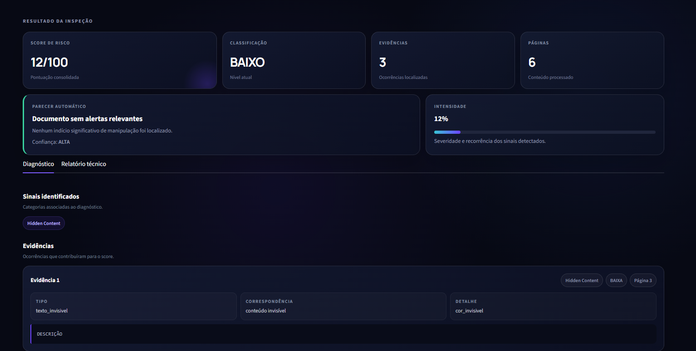
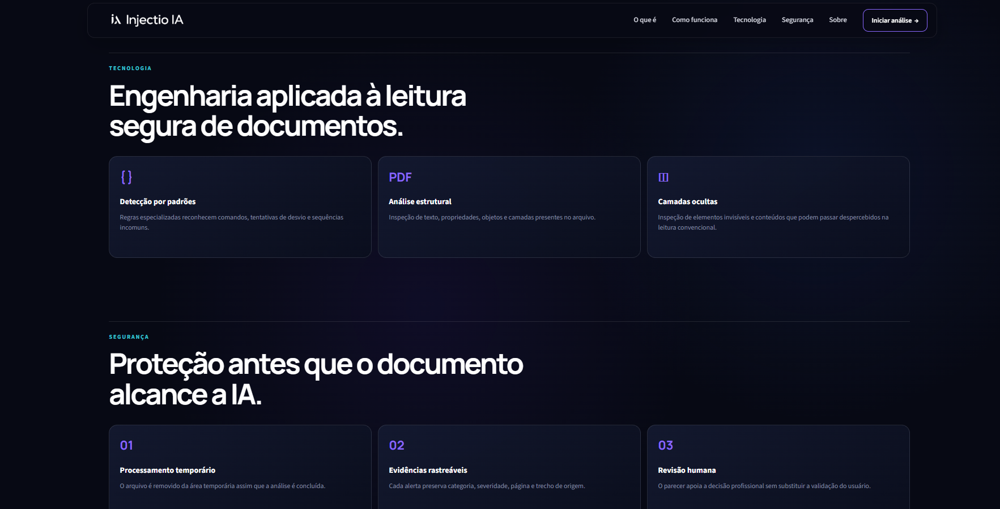

  

  <h3>Segurança documental antes que o conteúdo alcance a IA.</h3>

  

    
    
    
    
  

O Injectio IA inspeciona documentos PDF antes do processamento por sistemas de inteligência artificial. A aplicação identifica possíveis tentativas de prompt injection, organiza evidências e apresenta uma classificação de risco auditável.

  

O que o projeto faz

Analisa texto visível, conteúdo oculto e metadados do PDF.

Detecta padrões associados a instruções maliciosas.

Calcula score e nível de risco.

Localiza evidências por página e categoria.

Gera relatório técnico em JSON.

Disponibiliza interface web e API REST.

Como funciona

1. Envio

2. Inspeção

3. Resultado

O usuário seleciona um PDF.

Conteúdo, metadados e camadas ocultas são avaliados.

O sistema apresenta score, classificação e evidências.

Interface

<table>
  <tr>
    <td width="50%" align="center">
       
      <b>Resultado da inspeção</b>
    </td>
    <td width="50%" align="center">
       
      <b>Funcionamento e fluxo de análise</b>
    </td>
  </tr>
  <tr>
    <td colspan="2" align="center">
       
      <b>Tecnologia e medidas de segurança</b>
    </td>
  </tr>
</table>

Tecnologias

Python · Streamlit · PyMuPDF · pypdf · FastAPI · Uvicorn · pytest

Executar localmente

git clone https://github.com/anaflaviabitu/injectio-ia.git
cd injectio-ia
python -m venv .venv

No Windows:

.venv\Scripts\activate
pip install -r requirements.txt
streamlit run app.py

API e testes

# API
uvicorn main:app --reload

# Testes
pip install -r requirements-dev.txt
pytest -q

Método

Endpoint

Finalidade

GET

/health

Verifica a disponibilidade da API

POST

/analisar-seguranca

Analisa um documento PDF

Estrutura

Ver arquivos do projeto

injectio-ia/
├── app.py
├── main.py
├── detector.py
├── extractor.py
├── patterns.py
├── avaliar_dataset.py
├── dataset/
├── tests/
├── docs/
├── injectio-logo.png
├── injectio-hero.png
├── requirements.txt
└── requirements-dev.txt

Observação

Projeto experimental baseado em regras heurísticas e um dataset sintético de validação. Os resultados apoiam a análise, mas não substituem revisão humana ou ferramentas especializadas de segurança.

Autora

Ana Flávia Bitu

GitHub: https://github.com/anaflaviabitu